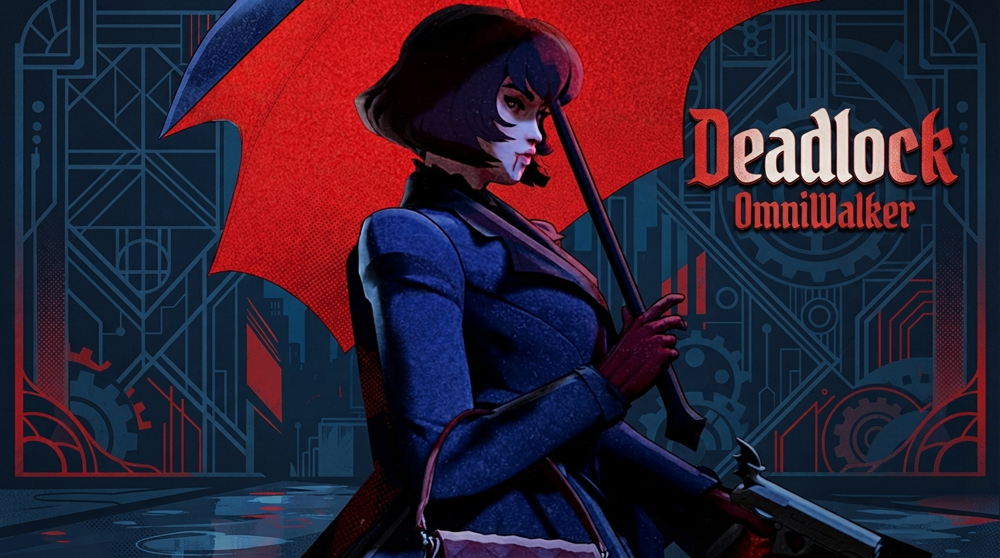

# 🎯 Deadlock: Safe Client-Side UI Mods & QoL Collection

  

  

  
  
  
  

  <b>⬇ DOWNLOAD THE MODS ⬇</b>

  

  
  

  

> 🎯 **Your complete toolkit for Deadlock** — enhance your HUD, customize your interface, and improve your quality of life. Designed for **client-side only** use. 🛡️ **Safe for the Playtest** — no memory injection, no aimbots, no ESP. Only official Panorama UI file modifications and cosmetic mods.

## 📖 About the Game

**Deadlock** is Valve's highly anticipated third-person hero shooter mixed with MOBA mechanics. Two teams of six control heroes with unique weapons and supernatural abilities, pushing lanes and fighting toward the opposing Patron.

Despite being **invite-only and technically unreleased**, Deadlock has already smashed records, peaking at over **262,000 concurrent players** on Steam after the release of the chess-playing hero Solomon. The game remains in active development, with Valve stating it's still too unfinished for a public release.

**Key Game Features**:
- 🎯 **Third-Person Hero Shooter** — precision aiming mixed with MOBA abilities
- 🗺️ **Lane-Based Progression** — push lanes, collect souls, and buy upgrades
- 🦸 **Diverse Hero Roster** — from chess wizards to vampire hunters
- 🎨 **Heavily Moddable UI** — Valve uses Panorama for its interface, allowing client-side customization

## ⚠️ IMPORTANT WARNING — READ BEFORE USING

**Deadlock is an online multiplayer game with Valve Anti-Cheat (VAC).**

| Enforcement Risk | Details |
|------------------|---------|
| **VAC Protection** | Deadlock uses Valve's anti-cheat system, similar to CS2 and Dota 2 |
| **Ban Risk** | Using **memory-editing cheats** (aimbots, ESP) in online matches will result in a VAC ban |
| **Safety of This Repo** | This repository contains **ONLY client-side UI mods and cosmetic mods**. These modify local files and do **NOT** read or write game memory |
| **Valve's Stance** | Valve has historically allowed client-side UI mods in their games (like CS:GO and Dota 2) as long as they don't provide an unfair gameplay advantage |

> 🚫 **DO NOT USE AIMBOTS OR ESP.** This repository is strictly for **quality-of-life UI improvements** and **cosmetic mods**. If you want cheats, look elsewhere, but be prepared for a permanent ban.

## 🔒 Safety & Security

| Safety Feature | Description |
|----------------|-------------|
| **Client-Side Only** | Modifies only local UI files (Panorama) via `.vpk` addons |
| **No Memory Injection** | Does not read or write game memory. No DLL injection |
| **No Gameplay Changes** | Every action (buying items, editing builds) still goes through the game's own commands |
| **Backup Recommended** | Always back up your `gameinfo.gi` before editing it |

## 🔥 Featured Mods

### 🎮 Deadlock Easy Build Editor

**Source:** GitHub (luccahp1) | **Updated:** October 18, 2026 | **Type:** Client-Side UI Mod

A client-side UI mod that turns the hero build editor into a single screen. No more flipping between tabs to add items.

**Features**:
- **Shop and Build on One Screen** — The All Items shop sits on the left, your build on the right.
- **Free Section Placement** — Grab a section by its MOVE tag and drop it anywhere. Sections stay where you put them.
- **Right-Click Menu** — Right-click empty space to create categories or search for items.
- **Toolbar** — Quick-add sections (Early, Mid, Late, Situational), compact all, and hide shop.
- **Save/Cancel Pinned** — No scrolling to find the save button.

**Installation**:
1. Download `pak42_dir.vpk` from the button above.
2. Copy it into `Steam\steamapps\common\Deadlock\game\citadel\addons\`.
3. Ensure `game\citadel\gameinfo.gi` lists `Game citadel/addons` under `SearchPaths`.
4. Restart Deadlock.
5. Open the shop, pick a build, press **Edit**, then **Easy Editor**.

> **Note**: If you already have a `pak42_dir.vpk` from another mod, rebuild with a free number: `python build.py --pak 43`.

### 🎨 Cosmetic Mods Collection

**Source:** AyakaMods | **Type:** Cosmetic Character Mods

A collection of community cosmetic mods that change character models and voice lines. These are purely visual and do not affect gameplay.

**Available Mods**:
- **Abram: GIANT Anya** — Replaces Abram with a giant version of Anya, featuring cute voicelines, pink particle effects, and dress/hair physics.
- **Cheems Guardians** — Changes Guardians to Cheems with a bonk sound effect and headbob when parried.
- **Haze: Lenna (UMP9)** — Replaces Haze with Lenna from GFL2, featuring full voice support, weapon model adjustment, and character portraits.

**Installation**:
1. Download the desired mod from AyakaMods.
2. Place the `.vpk` files in `Steam\steamapps\common\Deadlock\game\citadel\addons\`.
3. Add `Game citadel/addons` to `gameinfo.gi` **ABOVE** the `Game citadel` line.
4. Restart the game.

## 🚀 QUICK START

### Step 1 Install BepInEx (Optional, for advanced mods)

1. Download **BepInEx** (x64) for Deadlock from the official GitHub.
2. Extract the contents into your Deadlock root folder.
3. Launch the game once to generate the `BepInEx\plugins` folder.

### Step 2 Install UI Mods

1. Download the `.vpk` files from the buttons above.
2. Copy them into `Steam\steamapps\common\Deadlock\game\citadel\addons\`.
3. Edit `game\citadel\gameinfo.gi` to include `Game citadel/addons`.
4. Restart the game.

### Step 3 Launch and Configure

1. Launch Deadlock.
2. Open the shop and press **Edit** to use the Easy Build Editor.
3. Enjoy the improved UI!

> ⚠️ **Antivirus warning?** `.vpk` files are just archives. If flagged, add the folder to exceptions.

### 📁 Folder Structure

### ⚠️ Important Notes
- **Client-side only** — no memory injection, no VAC risk for UI mods.
- **Game updates may break mods** — check for updates after patches.
- **No aimbots or ESP** — this repository does not contain cheats.
- **Backup `gameinfo.gi`** before editing.

## ❓ FAQ

### ❓ Is this a cheat or aimbot?
**No.** This is a collection of **client-side UI mods and cosmetic mods**. It does not read game memory, does not aim for you, and does not reveal enemies. It only changes the local user interface and character models.

### ❓ Will I get VAC banned?
**No, for these UI mods.** Valve has historically allowed client-side UI modifications in their games. However, **using aimbots or ESP WILL result in a ban**. This repository is strictly for quality-of-life UI improvements and cosmetic changes.

### ❓ Does the Easy Build Editor give me an advantage?
**No.** It only makes the build editor easier to use. Every action still goes through the game's own commands, and saving/sharing works exactly as it does without the mod.

### ❓ Does it work on Windows 11?
**Yes.** Fully compatible with Windows 10 and 11 (64-bit).

### ❓ How to uninstall?
Delete the `.vpk` file from the `addons` folder. Restore your `gameinfo.gi` backup if needed.

### ❓ What if the mod doesn't work?
- Ensure `gameinfo.gi` is correctly edited.
- Restart the game (mods load at startup only).
- Check for game updates that may have broken the mod.
- Verify the `.vpk` file is in the correct folder.

### ❓ Does Deadlock have anti-cheat?
**Yes.** Deadlock uses Valve Anti-Cheat (VAC), similar to CS2 and Dota 2. Valve has also experimented with unique anti-cheat methods, like turning cheaters into frogs during matches.

### ❓ Is Deadlock released?
**No.** It is currently **invite-only** and in early development. You need an invitation from a friend who already has access.

### ❓ What is the current player count?
Deadlock peaked at **262,145 concurrent players** on Steam after the release of the hero Solomon in October 2026.

## 🛠️ System Requirements

Based on community testing and Valve's developer wiki:

| Component | Minimum | Recommended |
|-----------|---------|-------------|
| **OS** | Windows 10 (64-bit) | Windows 11 (64-bit) |
| **Processor** | Intel Core i5 / AMD Ryzen 5000 series | Intel Core i7+ / AMD Ryzen 7+ |
| **RAM** | 8 GB | 16 GB |
| **GPU** | NVIDIA GTX 960 / AMD R9 380 | NVIDIA RTX 2080+ |
| **Storage** | 35 GB (game) + 100 MB (mods) | 35 GB SSD (game) + 100 MB (mods) |
| **Network** | Broadband Internet connection | Broadband Internet connection |

## 📢 Disclaimer

> **Fan-made UI mod collection.** Not affiliated with Deadlock developers, Valve Corporation, or any publisher.
>
> **Use at your own risk.** The author is not responsible for bans, save corruption, crashes, or damage.
>
> **This repository contains NO cheats.** Only client-side UI modifications and cosmetic mods. Using aimbots or ESP is against Valve's terms of service and will result in a VAC ban.
>
> **Back up your `gameinfo.gi` before use!**

## 🌟 Support This Project

- ⭐ **Star** this repository
- 🔔 **Watch** for updates
- 🐞 **Report** issues
- 💬 **Share** with friends!

© 2026 • Deadlock • Safe Client-Side UI Mods
